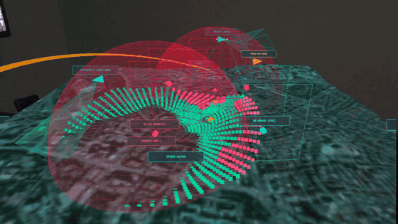
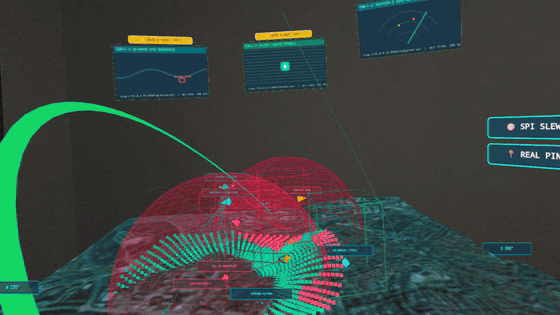
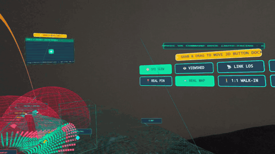
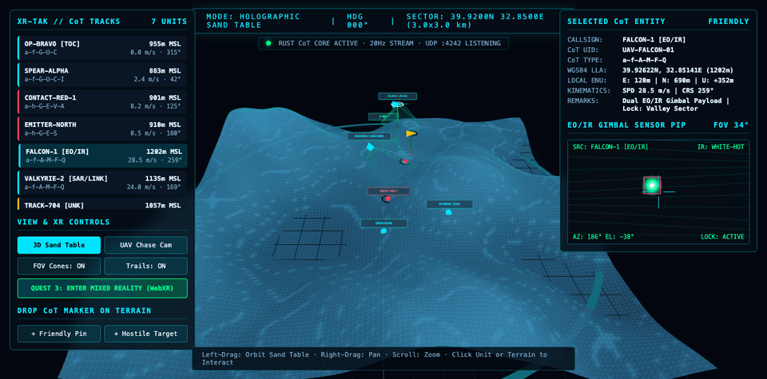

# XR-TAK — Open-Source 3D Mixed-Reality Geospatial Sand Table & CoT HUD

[](LICENSE)
[](https://gokselozgur5.github.io/xrtak/)
[](crates/xrtak-core)

**XR-TAK** is an open-source (`MIT`) Virtual Reality (VR) and Mixed-Reality (OpenXR / WebXR) 3D geospatial sand table and Cursor-on-Target (CoT) HUD for **ATAK-CIV** and desktop command posts.

Live browser / Meta Quest 3 WebXR build: **[https://gokselozgur5.github.io/xrtak/](https://gokselozgur5.github.io/xrtak/)**

## Meta Quest 3 Mixed Reality Passthrough Captures

| 1. Satellite 3D Sand Table & Viewshed | 2. Floating 3D Video Wall & 6DoF Handles | 3. Upright 3D VR Command Dock & CoT Pinning |
| :---: | :---: | :---: |
|  |  |  |
| *Esri Satellite + AWS Terrarium SRTM DEM terrain in Meta Quest 3 Mixed Reality Passthrough with 3D Viewshed LOS and radar domes.* | *Floating 3D sensor screens (`CAM-1 SAR`, `CAM-2 EO/IR`, `CAM-3 PTZ`) with independent 6DoF `GRAB & MOVE` handles and Quest 3 ray pointer.* | *Camera-facing upright 3D VR Command Dock (`SPI SLEW`, `VIEWSHED`, `REAL PIN`, `REAL MAP`) and 6DoF spatial pedestal ring.* |



It ingests standard **Cursor-on-Target (CoT)** XML streams (`UDP / TCP`) and projects friendly, hostile, neutral, and unknown air/ground tracks onto a 3D topographic and satellite terrain model with volumetric **EO/IR gimbal sensor FOV frustums**.

---

## MBSE & SOLID Architecture (`docs/architecture/MBSE_MODEL.md`)

| Phase | Subsystem | Stack & SOLID Boundary | Status |
| :--- | :--- | :--- | :--- |
| **Phase 1** | [`crates/xrtak-core`](crates/xrtak-core) & [`crates/xrtak-gateway`](crates/xrtak-gateway) | Rust CoT Engine, `ElevationProvider` (DIP), Point-to-Slew SPI (`b-m-p-s-p-i`), 3D Viewshed (`AGame_Actor_Viewshed`), 3D Spatial Video Wall, Three.js WebXR | **Complete (`:8090` / UDP `:4242`)** |
| **Phase 2** | [`atak-plugin/`](atak-plugin) | Bidirectional ATAK-CIV 5.2 Plugin Bridge (`XrTakMapComponent`, `CotBridgeTransport` DIP, `AtakItemSerializer` SRP) | **Complete (`javac` verified against ATAK 5.2 SDK)** |
| **Phase 3** | [`godot-xr/`](godot-xr) & [`xrtak-core::ffi`](crates/xrtak-core/src/ffi.rs) | Meta Quest 3 OpenXR Passthrough Sand Table + C-ABI FFI (`xrtak_lla_to_enu`, `xrtak_sample_relief_m`) + First-Person Tactical HUD (`xrtak-core::hud`) | **Complete (Godot 4.6 OpenXR)** |
| **Phase 4** | [`xrtak-core::geo`](crates/xrtak-core/src/geo.rs) | Bilinear DEM Engine (`RasterDemProvider`), SRTM `.hgt` 16-bit big-endian ingestion, and live WebXR terrain preset/DEM switching (`/api/terrain`) | **Complete (`REQ-DEM-01..04`)** |
| **Phase 5** | [`xrtak-core::zones`](crates/xrtak-core/src/zones.rs) & [`viewshed`](crates/xrtak-core/src/viewshed.rs) | 3D SAM/Radar Threat Domes (`ThreatDome`), Point-to-Point Link LOS (`compute_link_los`), and 3D Polygonal Geofences (`TacticalZone`) | **Complete (`REQ-TAC-01..03`)** |
| **Phase 6** | [`xrtak-core::aar`](crates/xrtak-core/src/aar.rs) | 4D After-Action Review (`AarTimeline`) ring-buffer, $\mathcal{O}(\log N)$ temporal interpolation, and interactive WebXR 4D timeline scrubber (`/api/aar`) | **Complete (`REQ-AAR-01..03`)** |
| **Phase 7** | [`xrtak-gateway`](crates/xrtak-gateway/src/main.rs) | Live TAK Server TCP (`:8087`) & UDP (`:4242`/`:4243`) Bridge, Auto-Recenter on Live CoT, `SIM+LIVE` toggle, and Quest 3 Controller 3D Laser Pointer (`b-m-p-c`) | **Complete (`REQ-COL-01`)** |
| **Phase 8** | [`xrtak-core::sapient`](crates/xrtak-core/src/sapient.rs) | BSI Flex 335 v2.0 SAPIENT Autonomous AI Threat Fusion (`POST /api/sapient`) and Automatic UAV EO/IR Gimbal SPI Slew (`b-m-p-s-p-i`) | **Complete (`ICD-09`)** |
| **Phase 9** | [`xrtak-core::zones`](crates/xrtak-core/src/zones.rs) | Dynamic ATAK `u-d-f` Polygon Zone Ingestion, Dynamic Hostile Emitter Threat Domes (`a-h-G-E-S`), and Interactive 3D Link LOS Chord UI (`POST /api/los`) | **Complete (`REQ-TAC-01..03`)** |
| **Phase 10** | [`xrtak-core::hud`](crates/xrtak-core/src/hud.rs) | 4D AAR Auto-Playback (`Play / Pause / 1x / 2x / 4x`), Replay Threat Dome Evaluation, and Helmet-Mounted First-Person AR Visor HUD Symbology (`GET /api/hud`) | **Complete (`ICD-10`)** |
| **Phase 11** | [`scripts/run_live_demo.sh`](scripts/run_live_demo.sh) | Turnkey Multi-Domain Live Demo Director exercising ATAK `u-d-f` polygons, SAPIENT AI auto-slew, SAM domes, 3D Link LOS, and Quest 3 laser cues | **Complete** |
| **Phase 12** | [`static/index.html`](crates/xrtak-gateway/static/index.html) & [`xr_sand_table.gd`](godot-xr/scripts/xr_sand_table.gd) | Diegetic 3D Holographic VR Control Dock, Single-Hand Grip Grab, Two-Handed Pinch-to-Scale & Twist-to-Rotate, 3D Terrain Ray Reticle, **1:1 Valley Walk-In Mode**, and **UAV Cockpit Ride-Along POV** | **Complete** |
| **Phase 13–14** | [`static/index.html`](crates/xrtak-gateway/static/index.html) | Universal VR Headset Mode (`Stereo 3D SBS`), Free 6DoF Spectate Locomotion (`WASD` + Thumbstick Fly), Upright Camera-Facing 3D Panels, and Spatial Grab Pedestal Ring | **Complete** |
| **Phase 15** | [`scripts/run_https_tls_proxy.py`](scripts/run_https_tls_proxy.py) & [`index.html`](index.html) | Native HTTPS WebXR TLS Gateway (`:8443`) + GitHub Pages Live Launcher (`https://gokselozgur5.github.io/xrtak/`) unlocking `navigator.xr` in Meta Quest 3 without browser flags | **Complete** |
| **Phase 16** | [`static/index.html`](crates/xrtak-gateway/static/index.html) | Independent 6DoF Draggable 3D VR Button Dock & 3D Video Wall Screens (`GRAB & MOVE`) + Draggable 2D Desktop HUD Panels (`localStorage` persisted) | **Complete** |
| **Phase 17** | [`crates/xrtak-gateway`](crates/xrtak-gateway/src/main.rs) | Real-World Satellite (`Esri`) & Topographic (`OpenTopoMap`) Tile Draping, Live **AWS Terrarium SRTM 24-bit DEM** Sync (`POST /api/terrain`), and Persistent Real CoT Pinning (`data/real_pins.json`, GeoJSON & CoT XML export) | **Complete** |
| **Phase 18–20** | [`static/index.html`](crates/xrtak-gateway/static/index.html) & [`LICENSE`](LICENSE) | City / Place Search (`Nominatim`), Real-World 3D Extruded OpenStreetMap Buildings (`Overpass API`), Live Camera 3D Video Wall, Meta Quest 3 Passthrough Captures, and `MIT` License | **Complete (`v1.0`)** |
| **Phase 21** | [`xrtak-core::geo`](crates/xrtak-core/src/geo.rs) & [`main.rs`](crates/xrtak-gateway/src/main.rs) | 3D Route Elevation Profile Curtain & Cross-Section Chart (`POST /api/elevation-profile`), Central-Difference Slope Telemetry (`sample_slope_deg`), and Offline 16-bit NASA SRTM `.hgt` Ingestion | **Complete (`ICD-11` / `REQ-ELV-01..02`)** |
| **Phase 22** | [`xrtak-core::mission`](crates/xrtak-core/src/mission.rs) & [`main.rs`](crates/xrtak-gateway/src/main.rs) | KML (`<Placemark>` / `<LineString>`) & QGroundControl (`.plan`) 3D Mission Corridor Ingestion (`POST /api/mission/import`), Per-Waypoint AGL Clearance & CFIT Warning Analysis | **Complete (`ICD-12` / `REQ-MIS-01..02`)** |

See [`docs/architecture/MBSE_MODEL.md`](docs/architecture/MBSE_MODEL.md) for the SysML Block Definition Diagram (BDD) and Interface Control Document (`ICD-01`..`ICD-08`), and [`docs/architecture/NEXT_GEN_MASTER_PLAN.md`](docs/architecture/NEXT_GEN_MASTER_PLAN.md) for the formal EARS requirements, mathematical algorithms, and execution roadmap.

---

## Key Capabilities

- **Shared Rust CoT Core (`crates/xrtak-core`):**
  - Zero-bloat Cursor-on-Target (`<event>`, `<point>`, `<contact>`, `<track>`, `<sensor>`) XML parser and generator.
  - Real-time **WGS84 (`lat, lon, hae`) $\leftrightarrow$ Local Tangent Plane (`East, Up, North` meters)** coordinate projection.
  - Volumetric 3D gimbal FOV pyramid extraction (`azimuth`, `elevation`, `hfov`, `vfov`, `range`).
- **Real-Time Telemetry & UDP CoT Bridge (`crates/xrtak-gateway`):**
  - Listens for raw CoT XML datagrams on `udp://0.0.0.0:4242`.
  - Streams 20 Hz world snapshots over Server-Sent Events (`/api/stream`) to WebXR and desktop clients.
  - Supports interactive 3D terrain pin-drop (`POST /api/spawn`), pin relocation (`POST /api/pin/move`), pin deletion (`POST /api/pin/delete`), and raw CoT XML injection (`POST /api/cot`).
- **3D Holographic Sand Table, Real Terrain & 3D Buildings:**
  - Live satellite (`Esri World Imagery`) and topographic (`OpenTopoMap`) tile draping paired with **AWS Terrarium 24-bit SRTM DEM** elevation grids.
  - Live **OpenStreetMap (`Overpass API`) 3D building footprint extrusion** and worldwide place geocoding (`Nominatim`).
  - 3D air/ground markers with altitude drop-stems, breadcrumb trails, and volumetric gimbal FOV cones.
  - Interactive **UAV Chase Cam**, **EO/IR Thermal Gimbal Targeting PiP**, and **Meta Quest 3 Mixed Reality (`immersive-ar`)** mode.

---

## Quick Start

### 1. Run the Rust CoT Gateway & WebXR Server

```bash
cargo run -p xrtak-gateway
```

Then open **`http://localhost:8090`** in your browser (or `https://<mac-lan-ip>:8443` via `./scripts/run_https_tls_proxy.py` inside the Meta Quest 3 browser).

### 2. Run the Turnkey Multi-Domain Live Demo Showcase

```bash
./scripts/run_live_demo.sh
```

This script injects an ATAK `u-d-f` polygonal ROZ (`KILLBOX DELTA`), a **BSI Flex 335 v2.0 SAPIENT** autonomous AI detection (`UAV_ROTARY 97%` with automatic `FALCON-1` EO/IR gimbal SPI lock), a mobile SAM/Radar emitter (`SA-15 GAUNTLET` projecting a 3D Threat Dome), a 3D Point-to-Point Link LOS check, and a Meta Quest 3 spatial laser cue (`b-m-p-c`).

### 3. Inject a Live CoT XML Packet via UDP (`:4242`)

```bash
printf '<event version="2.0" uid="COT-UDP-01" type="a-f-G-U-C" how="h-g-i-g-o"><point lat="39.9218" lon="32.8522" hae="990.0" ce="10" le="10"/><detail><contact callsign="PARALLAX-HQ"/><track course="90.0" speed="0.0"/><remarks>Live UDP CoT XML Packet</remarks></detail></event>' | nc -u -w 1 127.0.0.1 4242
```

### 4. Connect Meta Quest 3 & Live TAK Server (`:8087` TCP / `:4242` UDP)

1. **Connect to a Live TAK Server (TCP `:8087` or UDP `:4242`):**
   - In the right-hand **LIVE TAK SERVER & QUEST 3 BRIDGE** panel, enter your TAK Server TCP address (e.g., `192.168.1.50:8087`) and click **Connect**, or stream raw CoT XML directly to `udp://<mac-lan-ip>:4242`.
   - Click **Sim Units: OFF (LIVE)** to hide built-in rehearsal tracks and view only real TAK Server / ATAK-CIV tracks, or click **Auto-Center CoT** so the 3km x 3km sand table automatically centers on the first incoming live CoT coordinate.
2. **Meta Quest 3 WebXR (`immersive-ar` Color Passthrough):**
   - **Option A (Native HTTPS on Local LAN — `:8443`):** Run `./scripts/run_https_tls_proxy.py`, open `https://<mac-lan-ip>:8443` in Meta Quest Browser (click *Advanced -> Proceed* once for the self-signed SAN certificate), and click **ENTER AR (QUEST 3 PASSTHROUGH)**.
   - **Option B (GitHub Pages Public HTTPS):** Open **`https://gokselozgur5.github.io/xrtak/`** directly in Meta Quest Browser and click **ENTER AR (QUEST 3 PASSTHROUGH)**.
   - **Option C (USB ADB Reverse — zero Wi-Fi/TLS config):** Connect Quest 3 via USB-C, run `adb reverse tcp:8090 tcp:8090`, open `http://localhost:8090` in Meta Quest Browser, and click **QUEST 3: ENTER MIXED REALITY (WebXR)**.
   - Pull the Quest 3 trigger (`selectstart`) while pointing at any ridge or valley on the holographic table to drop persistent CoT pins (`REAL PIN`), slew EO/IR gimbals (`SPI SLEW`), or grab any `GRAB & MOVE` handle to reposition 3D panels in space.

### 5. Run Unit Tests

```bash
cargo test
```

---

## Strategic Roadmap (Phases 23–25)

| Milestone | Target Subsystem | Traceable Requirement (`EARS`) | Planned Capability |
| :--- | :--- | :--- | :--- |
| **Phase 23** | `xrtak-core::cog` & `xrtak-gateway` | `REQ-COG-01` | **Offline Cloud-Optimized GeoTIFF (COG) + DSM Bundle Draping:** Direct local ingestion of tiled RGB imagery COGs and Copernicus/SRTM DSM GeoTIFFs for disconnected field operations. |
| **Phase 24** | `xrtak-gateway` & WebXR Multi-User | `REQ-RTC-01` | **Multi-Operator Spatial Collaboration & WebRTC Voice:** Shared 6DoF Quest 3 laser cues (`b-m-p-c`), synchronized sand-table pose/scale, and spatialized team audio. |
| **Phase 25** | `xrtak-core::mission` & `atak-plugin` | `REQ-MAV-01` | **Direct Autopilot & CoT Route (`b-m-r`) Export:** Bidirectional 3D waypoint editing in Mixed Reality with one-click export to QGroundControl `.plan`, MAVLink, and ATAK `b-m-r` routes. |

