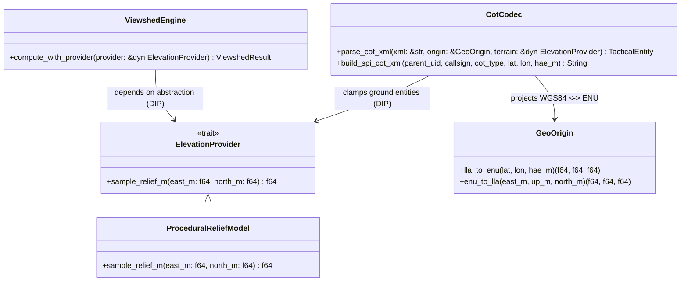

# XR-TAK — Model-Based Software Engineering (MBSE) Specification

## 1. Block Definition Diagram (BDD — SOLID Module Hierarchy)

## 2. Interface Control Document (ICD)

| Interface ID | Source Block | Target Block | Protocol / Payload | Rate / Trigger |
| :--- | :--- | :--- | :--- | :--- |
| `ICD-01` | `ATAK CotMapComponent` | `xrtak-gateway :4242` | Raw CoT XML (`<event version="2.0">`) over UDP | Event-driven / 1–10 Hz |
| `ICD-02` | `xrtak-gateway :8090` | `WebXR / OpenXR Client` | JSON `WorldSnapshot` over HTTP SSE (`/api/stream`) | 20 Hz (`50 ms`) |
| `ICD-03` | `WebXR / OpenXR Client` | `xrtak-core` (`CotCodec`) | `POST /api/spi` $\rightarrow$ `b-m-p-s-p-i` (`<link relation="p-p"/>`) | Operator Point-to-Slew |
| `ICD-04` | `WebXR / OpenXR Client` | `ViewshedEngine` | `POST /api/viewshed` $\rightarrow$ `ViewshedResult` (`72x28` rays) | Operator LOS Query |
