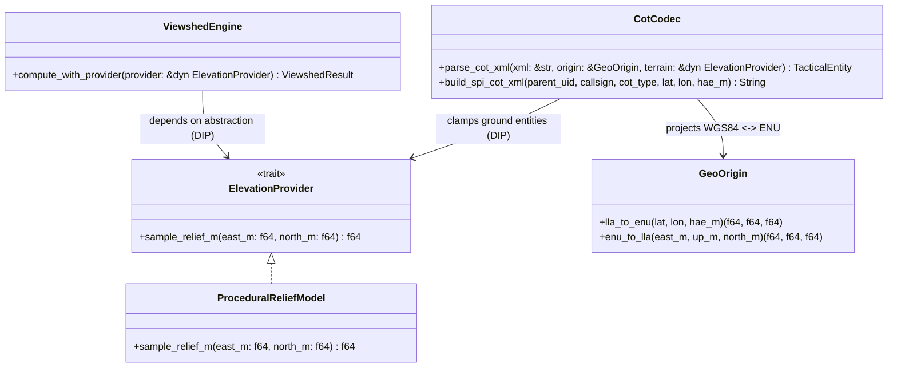
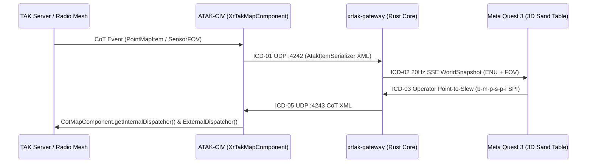

# XR-TAK — Model-Based Software Engineering (MBSE) Specification

## 1. Block Definition Diagram (BDD — SOLID Module Hierarchy)

## 2. Interface Control Document (ICD)

| Interface ID | Source Block | Target Block | Protocol / Payload | Rate / Trigger |
| :--- | :--- | :--- | :--- | :--- |
| `ICD-01` | `ATAK CotMapComponent` | `xrtak-gateway :4242` | Raw CoT XML (`<event version="2.0">`) over UDP | Event-driven / 1–10 Hz |
| `ICD-02` | `xrtak-gateway :8090` | `WebXR / OpenXR Client` | JSON `WorldSnapshot` over HTTP SSE (`/api/stream`) | 20 Hz (`50 ms`) |
| `ICD-03` | `WebXR / OpenXR Client` | `xrtak-core` (`CotCodec`) | `POST /api/spi` $\rightarrow$ `b-m-p-s-p-i` (`<link relation="p-p"/>`) | Operator Point-to-Slew |
| `ICD-04` | `WebXR / OpenXR Client` | `ViewshedEngine` | `POST /api/viewshed` $\rightarrow$ `ViewshedResult` (`72x28` rays) | Operator LOS Query |
| `ICD-05` | `xrtak-gateway` | `ATAK CotMapComponent` | Inbound CoT XML $\rightarrow$ `CotDispatcher.dispatch(CotEvent)` | Bidirectional XR $\rightarrow$ ATAK |
| `ICD-06` | `WebXR / OpenXR Client` | `xrtak-gateway` (`ElevationProvider`) | `GET / POST /api/terrain` $\rightarrow$ Bilinear DEM Grid (`RasterDemProvider`) | Phase 4 Terrain Sync |
| `ICD-07` | `WebXR / OpenXR Client` | `ThreatZoneEngine` & `ViewshedEngine` | `POST /api/los` $\rightarrow$ `LinkLosResult` & 3D `ThreatDome` / `TacticalZone` | Phase 5 & 9 Intervisibility & Dynamic Polygons |
| `ICD-08` | `WebXR / OpenXR Client` | `AarTimeline` (`xrtak-core::aar`) | `GET /api/aar` $\rightarrow$ Interpolated 4D `AarFrame` (`LIVE` $\leftrightarrow$ `REPLAY` `1x/2x/4x`) | Phase 6 & 10 4D Time-Machine |
| `ICD-09` | `SAPIENT Edge AI Node` | `xrtak-core::sapient` | `POST /api/sapient` $\rightarrow$ BSI Flex 335 Detection $\rightarrow$ CoT Threat + Auto-Slew SPI | Phase 8 SAPIENT AI Threat Fusion |
| `ICD-10` | `WebXR / OpenXR Visor` | `xrtak-core::hud` | `GET /api/hud` $\rightarrow$ Helmet-Mounted AR Visor Bearing / Slant-Range / Elevation Cues | Phase 10 AR Tactical Visor HUD |
| `ICD-11` | `WebXR / OpenXR Client` | `xrtak-core::geo` (`RasterDemProvider`) | `POST /api/elevation-profile` & SRTM `.hgt` Ingestion $\rightarrow$ `ElevationProfileResult` | Phase 21 Elevation Profile & Slope Analytics |
| `ICD-12` | `WebXR / OpenXR Client` | `xrtak-core::mission` | `POST /api/mission/import` (KML / QGC `.plan`) $\rightarrow$ `MissionCorridorResult` (AGL & CFIT) | Phase 22 3D Mission Corridor & AGL Clearance |
| `ICD-13` | `WebXR / OpenXR Client` | `xrtak-core::cog` (`ingest_geotiff_dsm`) | `POST /api/terrain/geotiff` (Float32/Int16 GeoTIFF DSM + ModelTiepoint) $\rightarrow$ `GeoTiffDsmResult` | Phase 23 Offline GeoTIFF / COG DSM Draping |
| `ICD-14` | `WebXR / OpenXR Peers` | `xrtak-core::collab` (`CollabRoomState`) | `POST /api/collab/sync` & SSE `operators` / `table_pose` $\rightarrow$ Shared 3D Laser & PTT Voice | Phase 24 Multi-Operator Spatial Collaboration |
| `ICD-15` | `WebXR / OpenXR Client` | `xrtak-core::mission` & `ATAK UDP :4243` | `POST /api/mission/export` $\rightarrow$ QGC `.plan` JSON + ATAK `b-m-r` Route CoT XML | Phase 25 Direct Autopilot & CoT Route Export |

See [`docs/architecture/NEXT_GEN_MASTER_PLAN.md`](NEXT_GEN_MASTER_PLAN.md) for the complete EARS requirements (`REQ-DEM`, `REQ-TAC`, `REQ-AAR`, `REQ-COL`), mathematical algorithms, and Phases 4–7 execution roadmap.

## 3. Bidirectional ATAK $\leftrightarrow$ XR-TAK Sequence Model

