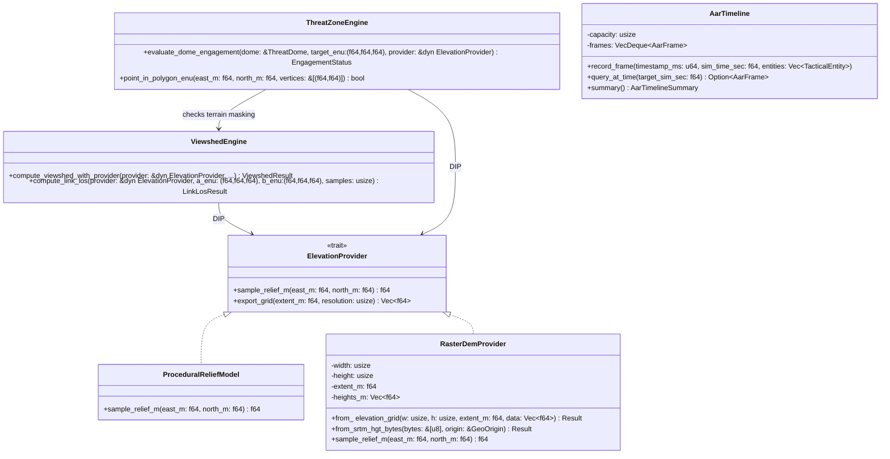

# XR-TAK Next-Gen Master Blueprint: Architecture, EARS Requirements, Algorithms & Execution Roadmap

> **Document ID:** `XRTAK-ARCH-002`  
> **Status:** Approved Baseline (`Phase 4` – `Phase 7`)  
> **Compliance:** MBSE (SysML BDD/ICD), SOLID Principles, INCOSE EARS (Easy Approach to Requirements Syntax), Atomic Verification Protocol  

---

## 1. Executive Vision & Industry Gap Analysis

Current military and tactical Extended Reality (XR) solutions bridging the **Team Awareness Kit (TAK / ATAK)** ecosystem suffer from a severe dichotomy:
1. **Heavyweight Proprietary Simulators (`VR-TAK` / `ARTAK` / `VBS4`):** Require workstation-class GPUs, gigabytes of pre-processed GIS packages, and closed government distribution channels.
2. **Flat 2D Sideloads:** Community workarounds that merely project a 2D Android ATAK window inside a headset without spatial 3D terrain, volumetric Line-of-Sight (LOS), or holographic sand table interaction.

**XR-TAK** bridges this gap as the first **zero-bloat, open-architecture Rust + WebXR + OpenXR + ATAK-CIV 3D Holographic Sand Table and First-Person Tactical Visor**. Having completed Phases 1–3 (Core CoT Engine, 3D Viewshed, Point-to-Slew SPI, Spatial Video Wall, ATAK 5.2 Plugin Bridge, and Godot 4.6 OpenXR + Visor HUD), **Phases 4–7** elevate XR-TAK into a field-ready, 4D spatial command-and-control (C2) platform:

- **Phase 4 — Real-World Digital Elevation Model (DEM / SRTM / Bilinear Heightmap) Engine:** Seamless ingestion of real-world elevation grids (`RasterDemProvider`) alongside procedural fallback via the `ElevationProvider` (DIP) boundary.
- **Phase 5 — 3D Tactical Geometries, Air Corridors & Volumetric Threat Domes:** Parsing and rendering CoT tactical shapes (`u-d-f` polygons, `b-m-r` routes) and 3D SAM/Radar hemisphere threat domes with live intervisibility (link LOS) checks.
- **Phase 6 — 4D After-Action Review (AAR) Time-Machine & Telemetry Recorder:** Lock-free/bounded ring-buffer state recording (`AarTimeline`) enabling operators to scrub backwards in time, pause, replay at `1x/2x/4x`, and inspect historical viewsheds and gimbal slews.
- **Phase 7 — Multi-Operator Collaborative Spatial Pointer & SAPIENT AI Threat Fusion:** Synchronized 3D laser pointers / tactical annotations across WebXR/OpenXR headsets (`ICD-06`) and ingestion of autonomous AI edge detections (BSI Flex 335 SAPIENT $\rightarrow$ CoT Threat Tracks).

---

## 2. Target Repository & Module Structure (SOLID Alignment)

All new capabilities strictly adhere to the **Single Responsibility (SRP)**, **Open/Closed (OCP)**, and **Dependency Inversion (DIP)** principles without breaking existing Phase 1–3 consumers:

```text
xrtak/
├── Cargo.toml
├── README.md
├── docs/
│   └── architecture/
│       ├── MBSE_MODEL.md                # SysML BDD + Sequence + ICD-01..ICD-08
│       └── NEXT_GEN_MASTER_PLAN.md      # This master specification (EARS, Algorithms, Roadmap)
├── crates/
│   ├── xrtak-core/
│   │   └── src/
│   │       ├── lib.rs                   # Public facade & TacticalWorld orchestrator
│   │       ├── domain.rs                # Core value types (Affiliation, Dimension, SensorCone, ThreatDome, TacticalZone)
│   │       ├── geo.rs                   # ElevationProvider trait, ProceduralReliefModel, RasterDemProvider (Bilinear DEM)
│   │       ├── viewshed.rs              # Radial Horizon-Slope Viewshed + Point-to-Point Intervisibility (Comms/Radar LOS)
│   │       ├── hud.rs                   # First-person Passthrough Visor HUD angular/slant-range cue solver
│   │       ├── aar.rs                   # [Phase 6] 4D After-Action Review (AarTimeline ring-buffer & time-scrubbing engine)
│   │       ├── zones.rs                 # [Phase 5] 3D Polygonal Geofence (ROZ/Killbox), Route Corridors & Threat Dome math
│   │       └── ffi.rs                   # C-ABI exports for Godot 4.6 GDExtension / Native OpenXR / Android JNI
│   └── xrtak-gateway/
│       ├── src/
│       │   └── main.rs                  # Async UDP :4242 CoT listener, 20Hz SSE stream, REST API (/api/dem, /api/aar, /api/los, /api/zones)
│       └── static/
│           └── index.html               # Three.js WebXR Sand Table + Visor HUD + 4D AAR Timeline Scrubber + 3D Threat Domes
├── atak-plugin/                         # ATAK-CIV 5.2 bidirectional Java plugin (XrTakMapComponent, CotBridgeTransport)
└── godot-xr/                            # Meta Quest 3 OpenXR native passthrough project
```

---

## 3. MBSE System Architecture (SysML Block Definition & Sequence)



---

## 4. Formal EARS Requirements Specification (INCOSE Standard)

Requirements are specified using the **EARS (Easy Approach to Requirements Syntax)** patterns (`Ubiquitous`, `Event-Driven`, `State-Driven`, `Unwanted Behavior`, `Optional`).

### 4.1 Phase 4 — Real-World DEM & Terrain Abstraction (`REQ-DEM`)
- **`REQ-DEM-01` (Ubiquitous):** The `xrtak-core` library **shall** compute all terrain elevations, ground entity clamping, and 3D viewshed intersections exclusively through the `ElevationProvider` trait interface.
- **`REQ-DEM-02` (Event-Driven):** **When** a raster elevation grid or SRTM HGT payload is loaded into `RasterDemProvider`, the system **shall** interpolate terrain height at any local tangent plane coordinate `(east_m, north_m)` using continuous bilinear interpolation across the 4 nearest grid cells.
- **`REQ-DEM-03` (Unwanted Behavior):** **If** a queried coordinate `(east_m, north_m)` falls outside the horizontal bounds `[-extent_m, +extent_m]` of the loaded `RasterDemProvider`, **then** the provider **shall** clamp the normalized UV coordinates to `[0.0, 1.0]` without panicking or returning `NaN`.
- **`REQ-DEM-04` (Event-Driven):** **When** a client switches terrain presets or uploads a DEM grid via `POST /api/terrain`, `xrtak-gateway` **shall** recompute ground entity altitudes, update the active `ElevationProvider`, and serve the synchronized heightmap mesh to WebXR/OpenXR clients via `GET /api/terrain`.

### 4.2 Phase 5 — 3D Threat Domes, Intervisibility & Geofence Zones (`REQ-TAC`)
- **`REQ-TAC-01` (Event-Driven):** **When** an operator queries point-to-point intervisibility between two coordinates or entities via `compute_link_los`, the system **shall** sample the terrain profile along the 3D chord connecting endpoints $A$ and $B$ and report whether terrain masks the line of sight, along with the exact first obstruction coordinate `(east_m, up_m, north_m)` and minimum terrain clearance in meters.
- **`REQ-TAC-02` (State-Driven):** **While** a hostile or friendly air-defense/radar entity defines a `ThreatDome` (`radius_m`, `ceiling_m`), the system **shall** evaluate whether airborne tracks reside inside the 3D hemisphere volume **and** maintain unobstructed terrain line-of-sight (`Radar Horizon / Terrain Masking`).
- **`REQ-TAC-03` (Event-Driven):** **When** a CoT tactical shape (`u-d-f` / `<shape><polyline>`) or zone definition is ingested, the system **shall** project all WGS84 vertices into local ENU meters, extrude a 3D volumetric prism (`floor_m` to `ceiling_m`), and detect entity boundary breaches using a 2D ray-casting (even-odd rule) + altitude interval check.

### 4.3 Phase 6 — 4D After-Action Review (AAR) Time-Machine (`REQ-AAR`)
- **`REQ-AAR-01` (Ubiquitous):** The `AarTimeline` engine **shall** maintain a bounded, chronological ring-buffer of `AarFrame` snapshots without unbounded heap growth.
- **`REQ-AAR-02` (Event-Driven):** **When** the simulation steps forward in live mode at interval $\Delta t$, the system **shall** append a keyframe snapshot to `AarTimeline` at a configurable capture cadence (e.g., `2 Hz` / every `500 ms`) up to `max_frames` capacity.
- **`REQ-AAR-03` (State-Driven):** **While** the WebXR/OpenXR operator scrubs the timeline into `REPLAY` mode at target timestamp $t_{\text{target}}$, the UI and API (`/api/aar/frame?t=...`) **shall** reconstruct the exact entity positions, headings, gimbal FOV cones, and SPI locks at $t_{\text{target}}$ via linear/spherical interpolation between bracketing keyframes without disrupting background UDP `:4242` ingestion.

### 4.4 Phase 7 — Collaborative Spatial Pointer & SAPIENT AI Threat Ingestion (`REQ-COL`)
- **`REQ-COL-01` (Event-Driven):** **When** an operator projects a 3D laser pointer onto the sand table in WebXR/OpenXR (`POST /api/pointer`), `xrtak-gateway` **shall** broadcast the 3D intersection marker (`east_m, up_m, north_m, operator_callsign`) in the 20 Hz `WorldSnapshot` and emit a standard CoT spot-map cue (`b-m-p-c`) to connected ATAK devices.

---

## 5. Core Mathematical Models & Algorithms

### 5.1 Algorithm 1: Bilinear Raster DEM Interpolation (`RasterDemProvider`)
Given a regular grid of dimensions $W \times H$ spanning $[-E_{\max}, +E_{\max}] \times [-N_{\max}, +N_{\max}]$:
1. Normalize local coordinates $(e, n)$ to continuous grid indices $(u, v) \in [0, W-1] \times [0, H-1]$:
   $$u = \text{clamp}\left(\frac{e + E_{\max}}{2 E_{\max}}, 0, 1\right) \cdot (W - 1), \quad v = \text{clamp}\left(\frac{n + N_{\max}}{2 N_{\max}}, 0, 1\right) \cdot (H - 1)$$
2. Extract integer cell indices and fractional weights:
   $$i_0 = \lfloor u \rfloor, \quad j_0 = \lfloor v \rfloor, \quad i_1 = \min(i_0 + 1, W - 1), \quad j_1 = \min(j_0 + 1, H - 1)$$
   $$\alpha = u - i_0, \quad \beta = v - j_0$$
3. Compute bilinear height $h(e, n)$:
   $$h(e, n) = (1 - \alpha)(1 - \beta) Z_{j_0, i_0} + \alpha(1 - \beta) Z_{j_0, i_1} + (1 - \alpha)\beta Z_{j_1, i_0} + \alpha\beta Z_{j_1, i_1}$$
- **Time Complexity:** $\mathcal{O}(1)$ per query (4 array lookups, 6 flops).

### 5.2 Algorithm 2: 3D Chord Intervisibility & Terrain Masking (`compute_link_los`)
To verify radio/radar/optical Line-of-Sight between Observer $A = (e_A, u_A, n_A)$ and Target $B = (e_B, u_B, n_B)$ across $N$ steps:
1. For each step $k \in \{1, \dots, N-1\}$, compute parameter $t_k = k / N$:
   $$P_k = A + t_k (B - A) = \big(e(t_k), u_{\text{ray}}(t_k), n(t_k)\big)$$
2. Sample terrain elevation at horizontal position:
   $$u_{\text{terrain}}(t_k) = \text{provider.sample\_relief\_m}\big(e(t_k), n(t_k)\big)$$
3. Compute vertical clearance $\Delta u_k = u_{\text{ray}}(t_k) - u_{\text{terrain}}(t_k)$:
   - If $\Delta u_k < 0$, the ray is **occluded** by terrain at $P_k$. Record the first occlusion point and minimum clearance $\min_k \Delta u_k$.
- **Time Complexity:** $\mathcal{O}(N)$ where $N \approx 64$ samples per link ($\sim 1.5\,\mu\text{s}$ in Rust).

### 5.3 Algorithm 3: 3D Volumetric Threat Dome & Polygon Containment
1. **Hemisphere + Terrain Horizon Check:** A target $T = (e_T, u_T, n_T)$ is threatened by a radar/SAM site at $S = (e_S, u_S, n_S)$ with radius $R_{\max}$ and altitude ceiling $H_{\max}$ iff:
   $$\|T - S\|_2 \le R_{\max} \;\land\; (u_T - u_S) \le H_{\max} \;\land\; \text{compute\_link\_los}(S, T).\text{clear} == \text{true}$$
2. **3D Polygonal Geofence (ROZ / Restricted Operating Zone):** Given polygon vertices $V_0, \dots, V_{m-1}$ in $(e, n)$ and altitude bounds $[u_{\min}, u_{\max}]$, a track is inside the prism iff $u \in [u_{\min}, u_{\max}]$ and the Jordan Curve even-odd ray-casting test toggles `inside = !inside` for every edge $(V_i, V_j)$ where:
   $$(n_i > n) \neq (n_j > n) \;\land\; e < \frac{(e_j - e_i)(n - n_i)}{n_j - n_i} + e_i$$

### 5.4 Algorithm 4: 4D AAR Keyframe Ring-Buffer & Temporal Interpolation
Given chronologically ordered keyframes $F_0, \dots, F_{k-1}$ with simulation timestamps $t_0 < t_1 < \dots < t_{k-1}$:
1. Use binary search (`partition_point`) in $\mathcal{O}(\log k)$ to locate bracketing frames $F_a, F_b$ such that $t_a \le t_{\text{query}} \le t_b$.
2. Compute interpolation factor $\lambda = \frac{t_{\text{query}} - t_a}{\max(t_b - t_a, 10^{-6})} \in [0, 1]$.
3. For each entity present in both frames, interpolate local ENU coordinates linearly and heading angle (`course_deg`) via shortest-arc angular interpolation:
   $$\Delta \theta = \big((\theta_b - \theta_a + 540^\circ) \bmod 360^\circ\big) - 180^\circ, \quad \theta(\lambda) = (\theta_a + \lambda \Delta \theta) \bmod 360^\circ$$

---

## 6. Phased Execution Roadmap & How We Start

We execute via **atomic, test-verified issues and pull requests** (`<50`–`150` lines per logical unit, `cargo test` green at every step):

| Phase | Milestone / Deliverable | Key Files | Verification Gate |
| :--- | :--- | :--- | :--- |
| **Step 0 (Now)** | **Master Blueprint & MBSE Documentation** | `docs/architecture/NEXT_GEN_MASTER_PLAN.md`, `MBSE_MODEL.md`, `README.md` | Architecture & EARS baseline committed |
| **Phase 4** | **Real-World DEM & Multi-Preset Terrain Engine** (`RasterDemProvider` + Bilinear Interpolation + Canyon/Alpine/Urban-Bowl/SRTM DEM presets + `/api/terrain`) | `crates/xrtak-core/src/geo.rs`, `crates/xrtak-gateway/src/main.rs`, `static/index.html` | Unit tests for bilinear math, out-of-bounds clamping, and live 3D terrain mesh switching |
| **Phase 5** | **3D Threat Domes, Link LOS & Polygonal Geofences** (`compute_link_los`, `ThreatDome`, `TacticalZone`, 3D radar hemispheres & LOS beams in WebXR) | `crates/xrtak-core/src/viewshed.rs`, `crates/xrtak-core/src/zones.rs`, `static/index.html` | Unit tests for chord terrain occlusion, radar horizon masking, and polygon ray-casting |
| **Phase 6** | **4D After-Action Review (AAR) Time-Machine** (`AarTimeline` ring-buffer, temporal interpolation, `/api/aar`, interactive WebXR timeline scrubber) | `crates/xrtak-core/src/aar.rs`, `crates/xrtak-gateway/src/main.rs`, `static/index.html` | Unit tests for ring-buffer eviction, $\mathcal{O}(\log N)$ time lookup, shortest-arc heading lerp, and live $\leftrightarrow$ replay UI |
| **Phase 7** | **Collaborative Spatial Laser Pointer & SAPIENT AI Threat Track Bridge** (`b-m-p-c` CoT laser cue + BSI Flex 335 SAPIENT detection $\rightarrow$ 3D Threat Track) | `crates/xrtak-core/src/lib.rs`, `crates/xrtak-gateway/src/main.rs`, `atak-plugin/` | End-to-end CoT XML + JSON verification |

### Immediate First Step (How We Start Right Now)
1. Review and lock this `NEXT_GEN_MASTER_PLAN.md` specification in the repository.
2. Open the **Phase 4** issue (`feat(geo): add RasterDemProvider bilinear DEM engine and dynamic terrain switching`) and implement `RasterDemProvider` in `crates/xrtak-core/src/geo.rs` with full unit test coverage and live 3D WebXR terrain switching.

---

## 7. Phase 21–28 Extended EARS Requirements & Strategic Roadmap

| Req ID | Subsystem | EARS Specification | Verification |
| :--- | :--- | :--- | :--- |
| `REQ-ELV-01` | `xrtak-core::geo` | **WHEN** an operator queries a multi-segment route polyline, the system **SHALL** compute cumulative distance, ASL/relief altitude, local terrain slope (degrees), total ascent/descent, and max grade. | `geo::tests::test_elevation_profile_and_slope` |
| `REQ-ELV-02` | `xrtak-core::geo` | **WHEN** a 16-bit signed big-endian NASA SRTM `.hgt` buffer is provided, the system **SHALL** normalize void samples (`-32768`) and construct a bilinear `RasterDemProvider`. | `geo::tests::test_srtm_i16_be_ingestion_and_presets` |
| `REQ-MIS-01` | `xrtak-core::mission` | **WHEN** a KML (`<Placemark>` / `<LineString>`) or QGroundControl (`.plan`) mission file is imported, the system **SHALL** extract ordered 3D waypoints (`lat, lon, alt_m`) and project them into local ENU coordinates. | `mission::tests::test_kml_mission_parsing_and_agl_clearance` |
| `REQ-MIS-02` | `xrtak-core::mission` | **WHILE** evaluating an imported mission corridor against the active `ElevationProvider`, **IF** any waypoint's Above-Ground-Level clearance (`agl_m`) falls below `min_safe_agl_m`, the system **SHALL** flag `clearance_violation = true` and increment `violation_count`. | `mission::tests::test_qgc_plan_parsing_and_relative_altitude` |
| `REQ-COG-01` | `xrtak-core::cog` | **WHEN** an offline Cloud-Optimized GeoTIFF (COG) RGB imagery + DSM bundle is loaded, the system **SHALL** parse IFD ModelTiepoint/PixelScale tags and drape Float32/Int16 elevation grids without internet connectivity. | `cog::tests::test_parse_geotiff_dsm_f32_with_tiepoint` |
| `REQ-RTC-01` | `xrtak-core::collab` | **WHILE** multiple Quest 3 / desktop operators are connected to the same gateway, the system **SHALL** synchronize spatial 3D laser pointers, table scale/pose, and PTT voice channels. | `collab::tests::test_multi_operator_presence_and_laser_sync` |
| `REQ-MAV-01` | `xrtak-core::mission` | **WHEN** an operator edits or approves a 3D mission corridor in XR, the system **SHALL** export MAVLink / QGroundControl `.plan` mission items and ATAK `b-m-r` CoT route XML directly to the autopilot/TAK mesh. | `mission::tests::test_export_qgc_plan_and_atak_bmr_cot_route` |
| `REQ-MAP-01` | `xrtak-core::tiles` | **WHEN** an operator selects `BingAerial`, `Sentinel2Cloudless`, `EsriWorldImagery`, or `OpenTopoMap`, the system **SHALL** resolve Web Mercator slippy coordinates and Bing Quadkeys (`0`..`3`). | `tiles::tests::test_latlon_to_tile_and_bing_quadkey` |
| `REQ-MAP-02` | `xrtak-core::tiles` | **IF** an offshore/sea tile at zoom > 13 returns a uniform light-beige `no-tile` placeholder, the system **SHALL** detect the low-variance placeholder and fall back to the parent `z=13` ocean tile. | `tiles::tests::test_offshore_placeholder_detection` |
| `REQ-COR-01` | `xrtak-core::corridor` | **WHEN** a dense waypoint track is provided, the system **SHALL** simplify the polyline via Ramer-Douglas-Peucker (`simplify_polyline_rdp`) and compute ground swath width from AGL altitude and camera HFOV / focal length. | `corridor::tests::test_camera_swath_width_and_rdp_simplification` |
| `REQ-COR-02` | `xrtak-core::corridor` | **WHEN** a simplified centerline and swath width are evaluated, the system **SHALL** construct a miter-clamped closed corridor polygon ring and export a valid KML `<Polygon>`. | `corridor::tests::test_buffered_corridor_polygon_and_kml` |
| `REQ-MAN-01` | `xrtak-core::manifest` | **WHEN** a WGS84 bounding box is queried, the system **SHALL** enumerate all intersecting 1°×1° Copernicus GLO-30 30m DEM COG tile identifiers (`Copernicus_DSM_COG_10_{N\|S}{lat:02}_00_{E\|W}{lon:03}_00_DEM`) and AWS Open Data S3 URLs. | `manifest::tests::test_copernicus_glo30_cell_naming_and_s3_urls` |
| `REQ-MAN-02` | `xrtak-core::manifest` | **WHEN** an offline mapset plan is requested across zoom range `[z_min, z_max]`, the system **SHALL** compute per-zoom Web Mercator tile counts, storage byte estimates, and a deterministic 64-bit FNV-1a `manifest_hash`. | `manifest::tests::test_mapset_manifest_tile_counts_and_hash` |

